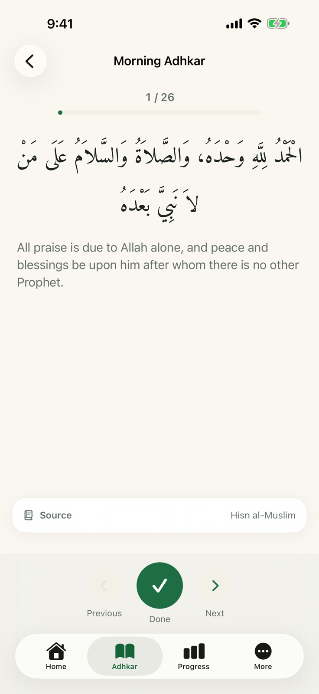
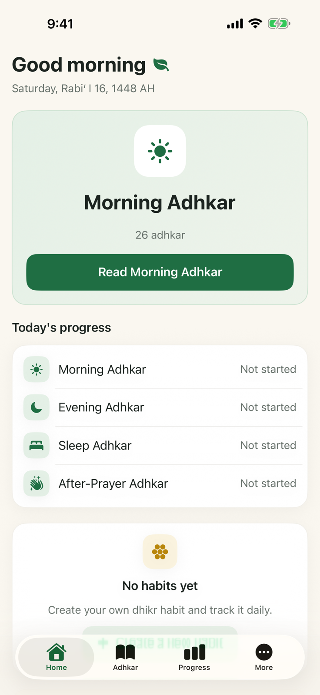
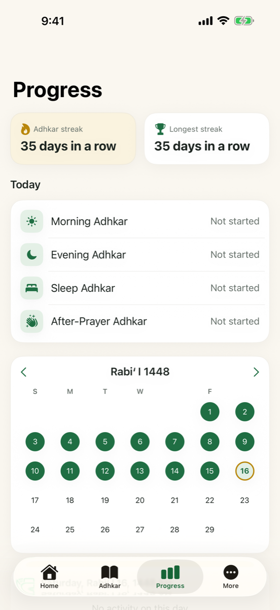

  

<h1 align="center">Mithkar · مذكار</h1>

  <strong>Your daily dhikr and habits, on time, in one place.</strong> 
  A calm adhkar companion for iPhone and iPad. Works offline, no account, no ads.

  <a href="https://apps.apple.com/sa/app/mithkar-daily-adhkar/id6806499983"><strong>Download on the App Store</strong></a>
  &nbsp;·&nbsp;
  <a href="https://mithkar.ibtihal.dev">mithkar.ibtihal.dev</a>

  <picture>
    <source media="(prefers-color-scheme: dark)" srcset="assets/05_reading_en_dark.png">
    
  </picture>
  <picture>
    <source media="(prefers-color-scheme: dark)" srcset="assets/01_home_en_dark.png">
    
  </picture>
  <picture>
    <source media="(prefers-color-scheme: dark)" srcset="assets/02_progress_en_dark.png">
    
  </picture>

This repo is the website for Mithkar: the landing page, privacy policy and contact page, in Arabic and English.

## The app

Mithkar brings your daily adhkar and spiritual routines together in one calm place, from morning and evening remembrances to prayer times and Hisn al-Muslim.

- **Focused reading.** A comfortable reading view with a repetition counter. Tap anywhere to record the next count.
- **Prayer times.** Accurate times for your location, with an on-device fallback that keeps them available offline.
- **Your progress.** A daily streak, the Hijri calendar, and insights that help you keep a steady rhythm.
- **Your own routines.** Group your daily awrad into routines, each with its own counters, goals and streak.
- **Widgets.** Four Home Screen widgets: time-aware adhkar, your streak, prayer times, and an interactive counter.
- **Designed around Arabic.** Arabic first, with full English support, light and dark modes, and the Hijri calendar built in.

Free on iPhone and iPad.

## Privacy

Mithkar runs on your device. Only when you turn on prayer times are your coordinates sent, to fetch accurate times.

- No account or sign-in
- Your data is stored on your device
- No advertising, analytics or tracking
- Location is optional and never logged

Full policy: [English](https://mithkar.ibtihal.dev/privacy-en.html) · [العربية](https://mithkar.ibtihal.dev/privacy.html)

## Contact

Feedback, bug reports, notes on the adhkar texts, and privacy questions: [support@ibtihal.dev](mailto:support@ibtihal.dev)
